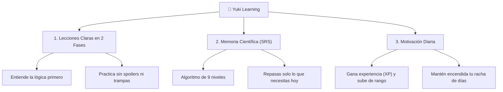

# Yuki Learning 🌸 · Tu Camino Hacia la Fluidez en Japonés

**Yuki Learning (雪ラーニング)** es una plataforma educativa interactiva diseñada para ayudarte a aprender, dominar y disfrutar el idioma japonés desde cero hasta los exámenes oficiales más avanzados del **JLPT (N5 a N1)**.

Nuestro objetivo es eliminar la frustración y la sobrecarga que tradicionalmente causa el estudio del japonés, reemplazándola con un sistema estructurado, dinámico y altamente motivador que se adapta a tu ritmo de vida.

---

## 🎯 ¿Por qué aprender con Yuki Learning?

Aprender japonés no se trata de memorizar listas interminables ni de pasar horas leyendo libros densos. Yuki Learning combina tres pilares fundamentales para un aprendizaje efectivo y duradero:

---

## ✨ Características Diseñadas para el Estudiante

### 1. 📖 Lecciones Intuitivas sin Spoilers
* **Fase 1 (Teoría Concreta):** Cada unidad comienza con una tarjeta conceptual clara, directa y visual. Sin paredes de texto aburridas: encuentras la fórmula del patrón gramatical, consejos mnemotécnicos y ejemplos cotidianos hablados por voces nativas.
* **Fase 2 (Práctica Guiada):** Te pones a prueba con ejercicios interactivos. Las frases ocultan las partículas o kanjis evaluados para que tu mente trabaje de verdad. Al responder, descubres inmediatamente la pronunciación completa, la traducción y la explicación pedagógica.

### 2. 🧠 Sistema de Repaso Espaciado Diario (SRS)
* **La ciencia contra el olvido:** ¿Sabías que el cerebro humano olvida el 70% de lo aprendido en menos de 48 horas si no lo refuerza? Nuestro algoritmo calcula el momento exacto en el que estás a punto de olvidar una palabra o ideograma kanji para presentártelo en tu sesión de repaso.
* **3 Botones de Calificación:**
  * **Difícil:** Si te costó recordarlo, la plataforma te lo volverá a mostrar pronto.
  * **Bien:** Progreso estándar y seguro en tu memoria.
  * **Fácil:** Salto acelerado para conceptos que ya dominas.
* **Pirámide de Memoria:** Observa cómo tus palabras avanzan desde la etapa de *Aprendiz*, pasan a *Gurú*, se consolidan como *Maestro* y finalmente quedan *Dominadas*.

### 3. 🎮 Gamificación que te Impulsa a Continuar
* **Racha de Días (Streaks):** Mantén encendido el fuego de tu constancia diaria. Un calendario semanal registra tus días activos para que no rompas el hábito.
* **Experiencia y Rangos:** Cada acierto, repaso y lección finalizada suma puntos de experiencia (XP) para subir de nivel de estudiante.
* **Avatar Personalizado:** Carga tu fotografía personal favorita desde tu dispositivo o elige entre avatares temáticos tradicionales japoneses.

### 4. 📱 Diseñado para Celulares, Tablets y Computadoras
* **Estudia donde estés:** La plataforma es 100% responsiva. Cuenta con una barra de navegación táctil optimizada para tu teléfono móvil para que aproveches cualquier momento del día (en el transporte, descansos o antes de dormir).
* **Transferencia de Progreso:** Si cambias de dispositivo o estudias en tu teléfono móvil, puedes transferir y respaldar tu progreso al instante con un solo clic mediante una clave de sincronización segura.

---

## 🗺️ La Ruta de Aprendizaje (De Cero a Maestro)

El currículo sigue el estándar oficial del **JLPT (Japanese Language Proficiency Test)** organizado como un árbol de habilidades secuencial:

| Nivel | Enfoque Principal | Lo que lograrás |
| :---: | :--- | :--- |
| **Módulo 0 Introducción** | **Hiragana & Katakana** | Aprenderás a leer y pronunciar los 92 caracteres silábicos básicos, los diacríticos sonoros (゛/ ゜) y las palabras extranjeras modernas en Katakana. |
| **Módulo 1 JLPT N5** | **Supervivencia y Rutinas Básicas** | Presentarte con cortesía (*desu*), señalar objetos en el espacio (*kore, sore, are*), dominar las partículas fundamentales (*wa, ga, wo, ni, de*) y tus primeros 100 kanjis. |
| **Módulo 2 JLPT N4** | **Conversación Cotidiana Informal** | Transición al estilo informal entre amigos, expresión de deseos, conjugaciones verbales en forma de diccionario, condicionales y comparaciones. |
| **Módulo 3 JLPT N3** | **Intermedio Práctico** | Comprensión de lecturas breves, artículos de opinión, conversaciones a velocidad natural y matices de intención. |
| **Módulos 4 y 5 JLPT N2 - N1** | **Avanzado y Dominio Nativo** | Lenguaje formal de negocios (*Keigo*), modismos tradicionales, comprensión auditiva compleja y lectura de periódicos o literatura. |

---

## 🚀 ¿Cómo empezar a estudiar hoy?

1. **Abre la plataforma** en tu navegador desde tu computadora o teléfono móvil.
2. **Elige tu punto de partida:**
   * Si nunca has estudiado japonés, selecciona **"Introducción (Hiragana/Katakana)"**.
   * Si ya conoces los silabarios, empieza directamente en **"JLPT N5"**.
3. **Personaliza tu perfil:** Elige tu nombre y sube tu foto o icono.
4. **Dedica 15 minutos diarios:** Completa una lección y vacía tus tarjetas de repaso SRS pendientes para garantizar que no olvides lo aprendido.

---

## 💻 Para Desarrolladores y Código Libre

Este proyecto es de código abierto bajo la licencia **MIT**. Si deseas revisar la arquitectura del código fuente, el modelo de base de datos relacional, la integración con Cloudflare Pages y R2, o desplegar tu propia instancia:

👉 **[Consulta la Documentación Técnica Completa aquí](docs/DOCUMENTACION_TECNICA.md)**

---

## 📄 Licencia

Yuki Learning se distribuye libremente bajo la **Licencia MIT**. Eres libre de utilizarlo, modificarlo y compartirlo para apoyar el aprendizaje del idioma japonés en todo el mundo.
