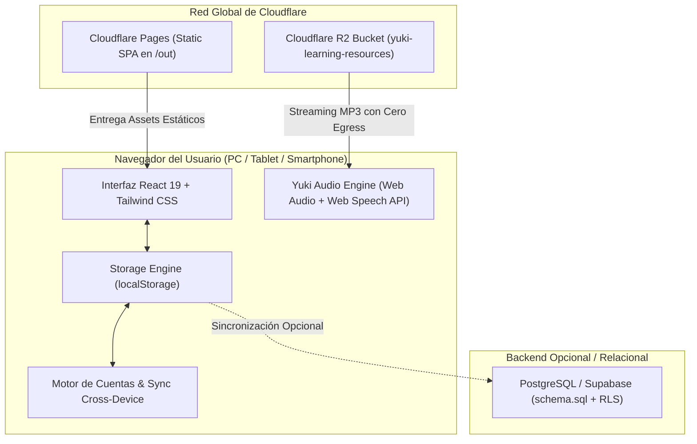

# Documentación Técnica de Arquitectura y Desarrollo · Yuki Learning 🌸

**Plataforma Web de Aprendizaje de Japonés (JLPT N5 - N1 con Repaso Espaciado y Gamificación)**  
*Licencia: Código Abierto (MIT) | Stack: Next.js 16 + React 19 + TypeScript + Tailwind CSS + Cloudflare Pages & R2*

---

## 1. Visión General de la Arquitectura

Yuki Learning está diseñada bajo una arquitectura moderna de **Jamstack / Single Page Application (SPA) con Exportación Estática**, garantizando:
* Cero costos de infraestructura de servidor gracias a la CDN perimetral global de **Cloudflare Pages**.
* Cero costos de transferencia de datos (*zero egress fees*) para gigabytes de audio en **Cloudflare R2**.
* Privacidad y resiliencia: El estado del estudiante, historial de calificaciones SRS y árbol curricular se gestionan mediante almacenamiento local seguro con sincronización criptográfica entre dispositivos.



---

## 2. Estructura del Repositorio

```text
├── DATABASE/                 # Especificación conceptual del modelo relacional
├── PLAN DE ESTUDIO/          # Plan curricular de cero a JLPT N1
├── ESCRITURA/                # Cuadernos de trazos Hiragana y Katakana
├── VOCABULARIO/              # Diccionarios ilustrados temáticos
├── GRAMATICA/                # Lecciones y audios nativos (Irodori, Marugoto, NHK)
├── ENTRENAMIENTO JLPT/       # Pruebas oficiales de escucha y exámenes simulados
├── docs/                     # Documentación técnica y guías de desarrollo
│   └── DOCUMENTACION_TECNICA.md
├── plataforma-web/           # Código fuente de la aplicación cliente (Next.js 16)
│   ├── database/             # Script SQL de producción (PostgreSQL / Supabase)
│   ├── next.config.mjs       # Configuración de compilación con export estático
│   ├── src/
│   │   ├── app/              # App Router (layout.tsx, globals.css, page.tsx)
│   │   ├── components/       # Componentes modulares y reactivos
│   │   │   ├── Dashboard.tsx         # Panel de control y gamificación
│   │   │   ├── CurriculumMap.tsx     # Árbol de habilidades de N5 a N1
│   │   │   ├── ActiveLesson.tsx      # Lección en 2 fases sin spoilers
│   │   │   ├── SRSReview.tsx         # Motor de flashcards con persistencia
│   │   │   ├── AuthModal.tsx         # Registro, login y migración móvil
│   │   │   └── ProfileSetupModal.tsx # Personalización y carga de avatar
│   │   ├── lib/              # Lógica pura de negocio
│   │   │   ├── storage.ts    # Persistencia atómica de progreso y mazo
│   │   │   ├── srs.ts        # Algoritmo matemático de repetición espaciada
│   │   │   ├── audio.ts      # Yuki Audio Engine (resolución R2 y TTS)
│   │   │   ├── auth.ts       # Hash SHA-256 y transferencia de sesión
│   │   │   └── lessonsData.ts# Catálogo pedagógico completo
│   │   └── types/            # Tipos e interfaces TypeScript estrictas
│   └── package.json          # Dependencias y scripts
└── README.md                 # Portada pública informativa para usuarios
```

---

## 3. Modelo de Base de Datos Relacional (`database/schema.sql`)

El proyecto incluye un esquema SQL empresarial listo para desplegar en **PostgreSQL** o **Supabase**, con seguridad a nivel de filas (**Row Level Security - RLS**) e índices optimizados:

### Tablas Principales:
1. **`users`**:
   * `id` (UUID): Identificador único vinculado a Supabase Auth.
   * `nombre`, `email`, `avatar_url`, `avatar_icon`.
   * `xp_total`, `racha_actual`, `racha_maxima`, `meta_diaria`.
   * `nivel_actual_jlpt` (ENUM: `INTRO`, `N5`, `N4`, `N3`, `N2`, `N1`).
   * `nivel_usuario`, `xp_nivel_actual`, `xp_proximo_nivel`.
2. **`lessons`**:
   * `id`: Clave alfanumérica única (ej. `intro_01`, `n5_02`).
   * `nivel_jlpt`, `orden`, `tipo` (gramática, kanji, vocabulario, escritura).
   * `teoria_json`: Objeto JSONB estructurado con concepto clave, fórmulas y ejemplos.
   * `preguntas_json`: Array JSONB de preguntas evaluativas anti-spoilers.
3. **`user_progress`**:
   * `id_usuario`, `id_leccion`, `estado` (`bloqueado`, `disponible`, `completado`).
   * `progreso_porcentaje`, `fecha_completado`.
4. **`study_items` (Catálogo Universal SRS)**:
   * `id`: Identificador del término.
   * `tipo`, `caracter` (kanji/palabra), `lectura`, `romaji`, `significado`.
   * `audio_url`: Ruta o URL CDN al archivo de pronunciación.
5. **`user_srs_reviews`**:
   * `id_usuario`, `id_item`, `nivel_memoria` (1-9).
   * `fecha_proxima_revision`, `total_aciertos`, `total_fallos`.

---

## 4. Algoritmo de Repaso Espaciado (SRS)

El cálculo de intervalos matemáticos se implementa en [`src/lib/srs.ts`](file:///c:/Users/Drhapso/Documents/PROYECTOS%20IA%20INDEPENDIENTES/PLATAFORMA%20DE%20IDIOMAS/JAPONÉS/Recursos%20Organizados/plataforma-web/src/lib/srs.ts) según la curva del olvido de Ebbinghaus:

| Nivel | Etapa SRS | Intervalo Nominal | En Calificación "Difícil" | En Calificación "Bien" | En Calificación "Fácil" |
| :---: | :---: | :---: | :---: | :---: | :---: |
| **1** | Aprendiz I | **4 horas** | Permanece en 1 | Sube a Nivel 2 | Sube a Nivel 3 |
| **2** | Aprendiz II | **8 horas** | Baja a Nivel 1 | Sube a Nivel 3 | Sube a Nivel 4 |
| **3** | Aprendiz III | **24 horas (1 día)** | Baja a Nivel 1 | Sube a Nivel 4 | Sube a Nivel 5 |
| **4** | Gurú I | **48 horas (2 días)** | Baja a Nivel 2 | Sube a Nivel 5 | Sube a Nivel 6 |
| **5** | Gurú II | **1 semana (7 días)** | Baja a Nivel 3 | Sube a Nivel 6 | Sube a Nivel 7 |
| **6** | Gurú III | **2 semanas (14 días)** | Baja a Nivel 4 | Sube a Nivel 7 | Sube a Nivel 8 |
| **7** | Maestro I | **1 mes (30 días)** | Baja a Nivel 5 | Sube a Nivel 8 | Sube a Nivel 9 |
| **8** | Maestro II | **4 meses (120 días)** | Baja a Nivel 6 | Sube a Nivel 9 | Sube a Nivel 9 |
| **9** | Dominado | **1 año (365 días)** | Baja a Nivel 7 | Permanece en 9 | Permanece en 9 |

---

## 5. Gestión Multimedia con Cloudflare R2

Dado que GitHub limita los archivos a 100 MB y no es adecuado para almacenar bibliotecas pesadas de audios MP3 o PDFs, se utiliza **Cloudflare R2** (S3 compatible con cero costos de transferencia).

### 5.1 Configuración de `rclone` (`~/.config/rclone/rclone.conf` o `%APPDATA%\rclone\rclone.conf`):
```ini
[r2]
type = s3
provider = Cloudflare
access_key_id = <TU_ACCESS_KEY_ID>
secret_access_key = <TU_SECRET_ACCESS_KEY>
endpoint = https://<TU_ACCOUNT_ID>.r2.cloudflarestorage.com
no_check_bucket = true
```

### 5.2 Comandos de Sincronización:
```bash
# Subir carpeta de gramática y audios de lecciones:
rclone sync "./GRAMATICA" "r2:yuki-learning-resources/gramatica" --progress

# Subir audios y material de entrenamiento JLPT:
rclone sync "./ENTRENAMIENTO JLPT" "r2:yuki-learning-resources/entrenamiento-jlpt" --progress

# Subir cuadernos y vocabulario ilustrado:
rclone sync "./ESCRITURA" "r2:yuki-learning-resources/escritura" --progress
rclone sync "./VOCABULARIO" "r2:yuki-learning-resources/vocabulario" --progress
```

### 5.3 Resolución Automática de URLs en el Frontend:
En [`src/lib/audio.ts`](file:///c:/Users/Drhapso/Documents/PROYECTOS%20IA%20INDEPENDIENTES/PLATAFORMA%20DE%20IDIOMAS/JAPONÉS/Recursos%20Organizados/plataforma-web/src/lib/audio.ts), la función `resolveAudioUrl()` intercepta cualquier ruta que comience por `/api/audio/...` y, si la variable de entorno `NEXT_PUBLIC_R2_AUDIO_BASE_URL` está definida, la convierte de forma transparente a la CDN de R2:
```typescript
const r2Base = process.env.NEXT_PUBLIC_R2_AUDIO_BASE_URL; // ej: https://pub-xxxxxx.r2.dev
```

---

## 6. Despliegue en Cloudflare Pages

La aplicación está optimizada para publicarse como **Static HTML Export**.

### 6.1 Configuración de `next.config.mjs`:
```javascript
/** @type {import('next').NextConfig} */
const nextConfig = {
  output: 'export',
  trailingSlash: true,
  images: { unoptimized: true },
};

export default nextConfig;
```

### 6.2 Parámetros en el Panel de Cloudflare Pages:
* **Framework preset:** `Next.js`
* **Root directory:** `plataforma-web`
* **Build command:** `npm run build`
* **Build output directory:** `out`
* **Variables de Entorno:**
  * `NEXT_PUBLIC_R2_AUDIO_BASE_URL`: URL pública de tu bucket R2 (`https://pub-xxxx.r2.dev` o dominio personalizado).
  * `NODE_VERSION`: `20`

---

## 7. Sistema de Autenticación y Sincronización Móvil (Cross-Device)

Para evitar la dependencia estricta de un servidor backend activo y permitir que los estudiantes lleven su progreso de la computadora al teléfono celular:
1. **Criptografía en el Cliente:** Se utiliza la API nativa `crypto.subtle.digest('SHA-256')` para asegurar las contraseñas localmente.
2. **Payload de Transferencia Base64:** La función `exportProgressSyncPayload()` empaqueta:
   ```json
   {
     "version": 1,
     "timestamp": "2026-11-03T00:00:00.000Z",
     "user": { ... },
     "curriculum": [ ... ],
     "srsDeck": [ ... ]
   }
   ```
   Genera una clave cifrada en Base64. Al abrir la web en el celular, el usuario simplemente pulsa **Dispositivos → Restaurar aquí** y pega su clave, restaurando inmediatamente el 100% de su racha, XP y tarjetas SRS.

---

## 8. Guía para Usar y Contribuir al Código Libremente

1. **Clonar el repositorio:**
   ```bash
   git clone https://github.com/Drhapso/Yuki-Learning.git
   cd Yuki-Learning/plataforma-web
   ```
2. **Instalar dependencias:**
   ```bash
   npm install
   ```
3. **Ejecutar servidor local:**
   ```bash
   npm run dev
   ```
4. **Verificar compilación estática de producción:**
   ```bash
   npm run build
   ```

